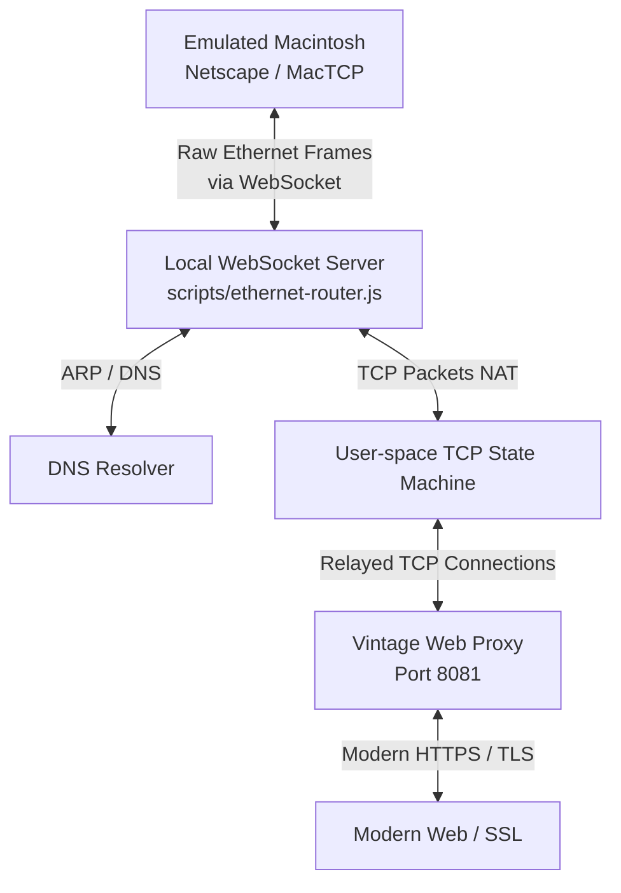

# Classic Macintosh Live Web Surfing (Ethernet & Proxy Integration)

This document describes how to bring up the userspace Ethernet routing stack and proxy bridge to enable live web surfing on emulated Macintosh operating systems (like System 7.5.3 or Mac OS 9) inside Infinite Mac.

---

## How It Works

Modern websites use HTTPS/TLS and heavy JavaScript/CSS, which vintage browsers (like Netscape Navigator 3.x/4.x or Internet Explorer 4.x/5.x) cannot parse or negotiate. 

Our integration routes the guest's Ethernet frames through a local userspace router and proxy server:



1. **DNS Interception**: DNS requests are intercepted and resolved locally on the host machine.
2. **TCP NAT**: Outgoing TCP connections are statefully NAT-translated to local sockets.
3. **Transparent Proxying**: Port 80 HTTP requests are redirected to a local translation proxy.
4. **Retro Optimization**: The proxy fetches pages securely, strips modern JS/CSS, rewrites `https://` links to `http://` (to keep the browser on the proxy path), and serves clean plain HTML or files (like `.sit` downloads) back to the guest.

---

## 1. Starting the Host Routing Stack

Before launching the emulator, you must start the userspace router and proxy server.

### Prerequisites
Make sure you have Node.js and dependencies installed:
```bash
npm install
```

### Start the Router & Proxy
Run the local WebSocket router and HTTP proxy:
```bash
npm run ethernet-router
```
This starts:
- The WebSocket Ethernet relay on `ws://localhost:8080`
- The HTTP/HTTPS Vintage Web Proxy on `http://127.0.0.1:8081`

### Start the Frontend Dev Server
In a separate terminal, start the Infinite Mac frontend:
```bash
npm run start
```
Open **`http://localhost:3127`** in your browser.

---

## 2. Launching the Emulator with Local Network Support

To connect the emulator to your local userspace router:
1. Open the Infinite Mac page (e.g. `http://localhost:3127`).
2. Click **"Customize..."** on your desired Mac OS version (Ethernet works best on **System 7.5.3**, **Mac OS 8.1**, or **Mac OS 9.0.4** running via Basilisk II or SheepShaver).
3. Scroll down and check the box for **"Enable Local Net (ws://localhost:8080)"**.
4. Click **"Run"** to boot the emulator.

*Tip: You can also automate this configuration by appending `&local_ethernet=true` to the browser URL, for example:*
*`http://localhost:3127/?appleTalk=true&local_ethernet=true`*

---

## 3. Guest OS Configuration

### A. Automatic Setup (DHCP) - Default Images
By default, the standard System 7.5.3 and Mac OS 9 disk images hosted on Infinite Mac are **already pre-configured to use DHCP on Ethernet**. 

Once the emulator boots and detects the virtual DaynaPort Ethernet card, it should automatically query our DHCP server, assign itself an IP address, and set the gateway and DNS. **No configuration steps are needed in this case.**

### B. Manual Setup (If DHCP is not active)
If the guest does not connect automatically, check or apply the following settings:

#### Open Transport (System 7.5.3 / Mac OS 7.6 / 8.x / 9.x)
1. Go to the **Apple Menu () -> Control Panels -> TCP/IP**.
2. Set **Connect via** to **Ethernet**.
3. Set **Configure** to **Using DHCP Server**.
4. Close the window and click **Save** when prompted.

If you prefer static configuration:
- **IP Address**: `192.168.1.15`
- **Subnet Mask**: `255.255.255.0`
- **Router Address (Gateway)**: `192.168.1.1`
- **Name Server Address (DNS)**: `192.168.1.1`

#### MacTCP (Early System 7 versions)
1. Go to the **Apple Menu () -> Control Panels -> MacTCP**.
2. Select **Ethernet** from the connection icon list.
3. Click **More...** and configure:
   - **Obtain Address**: Select **Server** (for DHCP) or **Manually**.
   - If manual: Set IP to `192.168.1.15`, Gateway to `192.168.1.1`, and Domain Name Server to `192.168.1.1`.
4. Close and click **OK**. You may need to restart the emulated Mac for MacTCP changes to take effect.

---

## 4. Vintage-Friendly Sites to Try

Once connected, open **Netscape Navigator** (or **Internet Explorer**) and try loading:
* **`http://wiby.me`** — Wiby is a vintage web search engine that indexes lightweight, retro-friendly sites.
* **`http://neverssl.com`** — A standard plaintext site designed to never enforce SSL, perfect for checking raw connectivity.
* **`http://text.npr.org`** — NPR's plain-text news feed.
* **`http://news.ycombinator.com`** — Hacker News (text-only view).
* **`http://google.com`** — Google's search page (rewritten and cleaned of script bloat).
* **`http://macintoshgarden.org`** — Classic software catalog for downloading vintage apps and games.

---

## 5. Troubleshooting & Tips

### Netscape Freezes on Startup (Gray Screen) / No WebSocket Logs
If you launch Netscape and the emulator immediately freezes on a gray screen, and there are no logs printed in your `ethernet-router` terminal, the persistent **`Saved HD`** (browser-persisted virtual disk changes) likely has corrupted preferences or a volume ID mismatch with a newly rebuilt `Infinite HD` image.

* **Quick Bypass:** Append `&saved_hd=false` to the URL to run a clean boot ignoring the saved state:
  `http://localhost:3127/1996/System%207.5.3?local_ethernet=true&saved_hd=false`
* **Permanently Resetting Saved State:** Open the browser developer console (**Inspect** -> **Console** tab) on the page and execute the following snippet to wipe the browser's Origin Private File System (OPFS):
  ```javascript
  (async () => {
      const root = await navigator.storage.getDirectory();
      const keys = [];
      for await (const key of root.keys()) {
          keys.push(key);
      }
      for (const key of keys) {
          await root.removeEntry(key, { recursive: true });
      }
      console.log("Saved HD cleared successfully!");
  })();
  ```
  Once it prints `Saved HD cleared successfully!`, reload the page.

### Netscape Freezes / Hangs on Modern Sites
Vintage web browsers cannot parse modern JavaScript or TLS configurations.
* The local proxy automatically intercepts default Netscape/Mozilla homepage requests to prevent loading heavy modern target redirects (like AOL) that crash the emulator.
* If a remote website hangs indefinitely, the proxy enforces a 15-second timeout and returns a `502 Bad Gateway` error to Netscape rather than locking up the cooperative Mac OS UI thread.
* For the best experience, use vintage-friendly search engines like [Wiby](http://wiby.me) or plaintext sites like [NeverSSL](http://neverssl.com).
